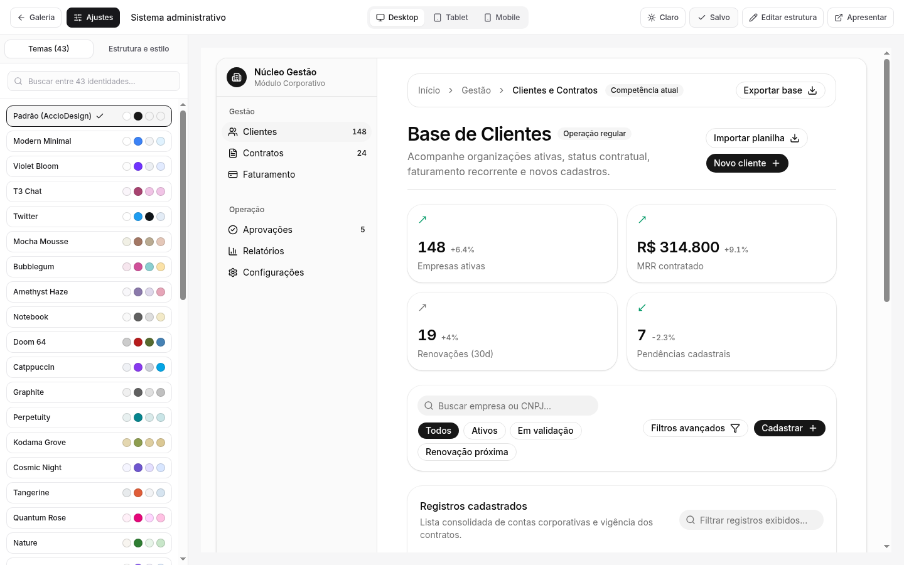
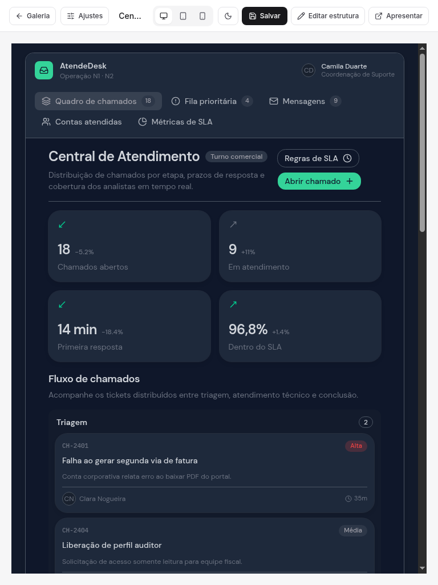
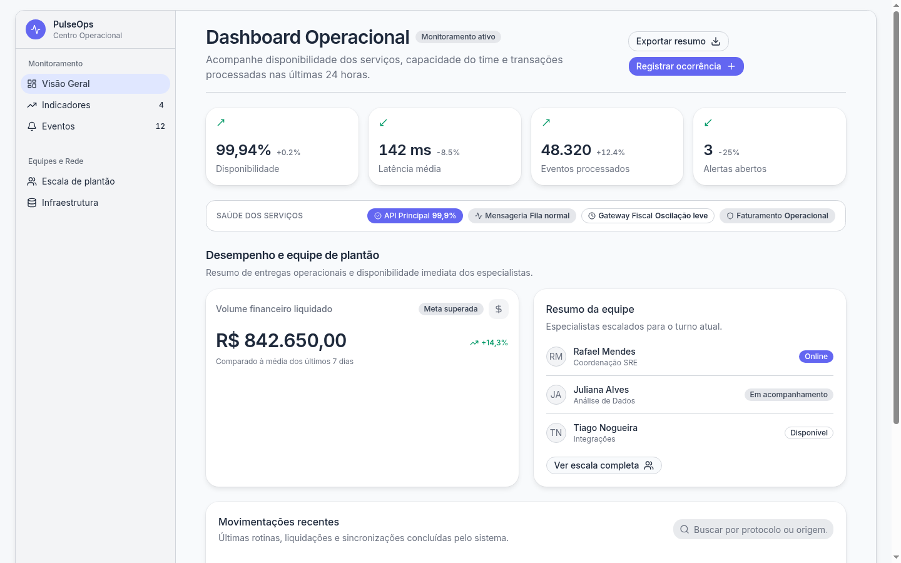

# AccioDesign

**Laboratório visual local para escolher estruturas prontas, experimentar identidades visuais e aprovar interfaces antes da implementação por agentes de IA ou equipes de engenharia.**

Construído sobre [Puck](https://github.com/puckeditor/puck), [shadcn/ui](https://ui.shadcn.com/), [Tweakcn](https://github.com/jnsahaj/tweakcn), [Tailwind CSS v4](https://tailwindcss.com/) e [React Router 7](https://reactrouter.com/), o AccioDesign funciona como um **provador visual de interfaces**: escolha um template ou comece em branco, teste 43 temas, tipografia, densidade e estilo de navegação em tempo real e edite blocos no Puck apenas quando necessário — tudo localmente, sem serviços pagos, autenticação ou nuvem proprietária.

---

## Fluxo de experimentação em 3 modos

| Modo | Rota | Papel no fluxo |
| --- | --- | --- |
| **Gallery (Início)** | `/` | Escolha um dos 3 templates iniciais, inicie uma estrutura em branco ou retome projetos salvos localmente. |
| **Experimentar (Playground)** | `/play/:projectId` | Provador visual rápido: alterne entre 43 presets Tweakcn, Claro/Escuro, tipografia, densidade, arredondamento, modo de navegação (`Sidebar`, `Rail compacto`, `Topo`) e viewports (`Desktop`, `Tablet`, `Mobile`) sem alterar o conteúdo do documento. |
| **Editar (Puck)** | `/projects/:projectId/edit` | Editor visual completo do Puck para reorganizar, editar propriedades, adicionar ou remover os 20 blocos disponíveis, com o plugin `Tema` integrado e Undo/Redo nativo. |
| **Apresentar** | `/projects/:projectId` | Renderização limpa e fiel para revisão ou demonstração, usando os mesmos componentes React e o tema persistido do projeto. |

Rotas legadas (`/*/edit` e `/*`) permanecem funcionais para compatibilidade com páginas criadas anteriormente.

---

## Capturas de tela

### Galeria inicial e projetos locais


### Modo Experimentar (Desktop, Tablet e Escuro + Menu Superior)





### Modo Apresentar


---

## Funcionalidades disponíveis (Implementadas)

### Galeria e 3 Templates Iniciais
- **Sistema administrativo:** navegação lateral adaptável, trilha de navegação (`BreadcrumbNav`), indicadores de carteira, barra de busca e filtros, listagem corporativa e formulário de cadastro rápido.
- **Dashboard operacional:** KPIs de disponibilidade e latência, saúde dos serviços (`StatusBadgeGroup`), card financeiro (`KpiCard`), equipe de plantão e tabela de movimentações recentes.
- **Central de atendimento:** indicadores de SLA, quadro visual de chamados editável (`KanbanBoard`), atendentes em linha e métricas por canal.
- **Estrutura em branco:** ponto de partida limpo para composição livre no editor Puck.

### Catálogo Administrativo (`shadcn/ui` + `Radix UI`)
20 componentes configurados em [app/puck/index.tsx](./app/puck/index.tsx), organizados em 6 categorias no painel do Puck e editáveis pelas propriedades nativas:

- **Navegação:** `Header`, `AppSidebar` (compatível com modos `Sidebar`, `Rail compacto` e `Menu superior`), `BreadcrumbNav`, `Footer`
- **Layout:** `PageHeader`, `DashboardGrid`, `TabsSection`, `Bento`, `KanbanBoard`, `Divider`
- **Cards:** `DashboardCard`, `CardGrid`, `UserSummaryCard`
- **Indicadores:** `Stats`, `KpiCard`, `StatusBadgeGroup`
- **Tabelas:** `DataTable` (com busca ao vivo no cliente), `KeyValueTable`
- **Formulários:** `FormBlock`, `FilterBar`

### Provador Visual de Identidades (Tweakcn)
Disponível tanto no **Modo Experimentar** quanto como plugin nativo (**Tema**) no editor Puck:

- **43 identidades visuais:** tema padrão do AccioDesign + 42 presets built-in do Tweakcn com amostras de cor.
- **Personalização em tempo real:** cores semânticas, tipografia (`font-sans`, `font-serif`, `font-mono` via Google Fonts), densidade visual (`spacing`), arredondamento (`radius`), sombras e alternância **Claro / Escuro**.
- **Troca de navegação não destrutiva:** alternar entre `Sidebar`, `Rail compacto` e `Menu superior` altera apenas `root.props.navigationMode` via contexto React, preservando integralmente blocos, slots e dados.
- **Isolamento do editor:** a identidade visual do próprio AccioDesign (Galeria, Playground e chrome do Puck) permanece neutra e independente do tema aplicado dentro do iframe de preview.

### Segurança e Persistência Local
- **Separação entre seed demonstrativo e dados de trabalho:**
  - [database.json](./database.json) versionado no repositório atua estritamente como **seed demonstrativo somente leitura** e nunca é sobrescrito por ações de usuário.
  - Projetos criados ou editados pelo usuário são gravados localmente em `.accio-data/projects.json` (e rotas legadas em `.accio-data/legacy-pages.json`), ambos **ignorados pelo Git** via [.gitignore](./.gitignore).
  - Na primeira execução após a atualização, páginas customizadas existentes fora do seed padrão são migradas automaticamente para `.accio-data/projects.json` sem perda de dados.
- **Zero serviços externos obrigatórios:** funciona 100% offline/local (apenas Google Fonts opcionais para fontes não locais).
- **Sanitização de temas importados:** allowlist estrita de tokens e bloqueio de CSS/JS inseguro em [app/theme/schema.ts](./app/theme/schema.ts).

---

## Decisões arquiteturais e limitações conhecidas

### Decisões arquiteturais
1. **Preview isolado por portal em `<iframe>` no Modo Experimentar:** em [app/components/playground/preview-frame.tsx](./app/components/playground/preview-frame.tsx), o preview utiliza `<Render>` do Puck com os mesmos componentes React da página publicada dentro de um `<iframe>` sincronizado com as folhas de estilo do app e com `applyThemeToDocument(themeDoc, iframeDoc)`. Isso garante responsividade real por media queries (`Desktop`, `Tablet`, `Mobile`), isolamento total entre o tema testado e o chrome da ferramenta, além de paridade visual com o Modo Apresentar.
2. **Estado visual concentrado em `root.props`:** tema (`root.props.theme`), densidade (`root.props.density`) e modo de navegação (`root.props.navigationMode`) ficam em `root.props` do mesmo documento Puck (`AppData`), permitindo transição direta entre **Experimentar**, **Editar** e **Apresentar** sem duplicar formatos ou reconstruir blocos.
3. **Suite de testes sem novas dependências externas:** `npm test` usa `esbuild` (já presente via Vite) + `node:test` nativo do Node.js para validar geração de templates, preservação de conteúdo, isolamento de persistência e integridade do catálogo Puck.

### Limitações conhecidas
- A persistência é baseada em arquivos JSON locais (`.accio-data/`) voltada para uso individual/local, sem controle de concorrência multiusuário, autenticação ou banco de dados externo.
- No Modo Experimentar, alterações em cores individuais avançadas, sombras detalhadas e importação/exportação CSS/JSON continuam concentradas na aba **Tema** dentro do Modo Editar (Puck), mantendo o provador focado em decisão rápida (presets, Claro/Escuro, navegação, tipografia, densidade e cantos).
- A alternância de navegação (`Sidebar`, `Rail`, `Topo`) aplica-se a templates e páginas que utilizam o bloco `AppSidebar`; estruturas em branco ou sem `AppSidebar` não exibem esse controle.

---

## Stack tecnológica

| Camada | Tecnologia |
| --- | --- |
| Framework & Roteamento | React 19, React Router 7 (SSR framework mode) |
| Bundler & Build | Vite 6, TypeScript 5.8 (`strict` + `verbatimModuleSyntax`) |
| Editor Visual | `@puckeditor/core` 0.24 |
| Design System & UI | Tailwind CSS v4 (`@tailwindcss/vite`), shadcn/ui (`radix-rhea`), Radix UI, Lucide |
| Temas & Tokens | Módulos adaptados do Tweakcn (Apache 2.0) |
| Testes Automatizados | `node:test` + `esbuild` |

---

## Instalação e execução local

### Pré-requisitos
- **Node.js** `>= 20.0.0`
- **npm** (ou gerenciador compatível)

### Passo a passo

```bash
# 1. Clonar o repositório
git clone https://github.com/leogoecking/AccioDesign.git
cd AccioDesign

# 2. Instalar dependências
npm install

# 3. Iniciar o servidor de desenvolvimento
npm run dev
```

Após iniciar o servidor:
- **Galeria inicial:** `http://localhost:5173/`
- **Modo Experimentar:** clique em **Experimentar** em qualquer template para abrir `/play/:projectId`
- **Modo Editar (Puck + Tweakcn):** `/projects/:projectId/edit`
- **Modo Apresentar:** `/projects/:projectId`

### Scripts disponíveis

```bash
npm test            # Executa a suíte de testes automatizados (node:test + esbuild)
npm run typecheck   # Gera rotas tipadas do React Router e executa tsc
npm run build       # Gera os bundles client e SSR em ./build
npm run start       # Inicia o servidor de produção via react-router-serve
```

---

## Projetos open source utilizados

- **[Puck](https://github.com/puckeditor/puck)** — Editor visual open source para React (MIT).
- **[puck-configs](https://github.com/puckeditor/puck-configs)** — Configurações de referência `shadcn-twblocks` que serviram de base para os blocos iniciais *(sem arquivo `LICENSE` próprio confirmado na raiz do checkout utilizado; nenhuma licença não confirmada é atribuída a ele)*.
- **[Tweakcn](https://github.com/jnsahaj/tweakcn)** — Presets, gerador de tokens Tailwind v4, sombras e manipulação de temas (Apache 2.0).
- **[shadcn/ui](https://github.com/shadcn-ui/ui)** — Primitivos e convenções de interface (MIT).
- **[Radix UI](https://github.com/radix-ui/primitives)** — Primitivos acessíveis de UI (MIT).
- **[Tailwind CSS](https://github.com/tailwindlabs/tailwindcss)**, **[React Router](https://github.com/remix-run/react-router)**, **[Vite](https://github.com/vitejs/vite)** e **[Lucide](https://lucide.dev)**.

---

## Roadmap

### Implementado
- [x] Estrutura base com Puck + React Router 7 + Vite + Tailwind CSS v4
- [x] Catálogo administrativo shadcn/ui com 20 blocos em 6 categorias (incluindo `KanbanBoard`)
- [x] Integração do Tweakcn como plugin nativo no Puck (`Tema`), com 43 presets, editor de tokens em tempo real e Claro/Escuro
- [x] Galeria visual inicial, 3 templates completos em pt-BR e fluxo unificado em 3 modos (**Experimentar**, **Editar**, **Apresentar**)
- [x] Troca instantânea de navegação (`Sidebar`, `Rail compacto`, `Menu superior`), densidade e tipografia preservando dados do documento
- [x] Separação entre seed demonstrativo versionado (`database.json`) e projetos locais ignorados pelo Git (`.accio-data/`)

### Planejado (próximas etapas)
- [ ] **Integração com TokenBridge:** sincronização bidirecional e validação de contratos de design tokens para handoff padronizado.
- [ ] **Exportação para agentes de IA:** geração de pacotes de contexto (estrutura de componentes Puck + tokens aprovados + diretrizes visuais) prontos para consumo por agentes implementadores.
- [ ] **Comparação rápida entre identidades:** visualização lado a lado e histórico nomeado de variações aprovadas.

---

## Licenciamento e créditos

O **AccioDesign** é licenciado sob a **Apache License, Version 2.0**. Consulte:
- [LICENSE](./LICENSE) — texto integral da licença Apache 2.0;
- [NOTICE](./NOTICE) — avisos legais do projeto e atribuições;
- [THIRD_PARTY_NOTICES.md](./THIRD_PARTY_NOTICES.md) — mapeamento detalhado de módulos reutilizados, origens e adaptações realizadas.

## Exportar design para agentes (Fase 4)

No modo **Experimentar**, use **Exportar design**. Havendo alterações pendentes, confirme o salvamento antes de gerar o pacote; se o salvamento falhar ou houver uma nova edição durante a operação, a exportação é interrompida. O arquivo ZIP contém exclusivamente o projeto selecionado e é gerado localmente a partir do estado salvo, sem chamadas a IA.

| Arquivo | Conteúdo |
| --- | --- |
| `manifest.json` | Versão do contrato, identificação e compatibilidade. |
| `design.json` | Documento Puck completo do projeto salvo. |
| `tokens.json` | Tokens aprovados de Light e Dark, com campos sem correspondência no TokenBridge. |
| `theme.css` | Variáveis e sombras usadas no preview e associações Tailwind CSS v4. |
| `DESIGN.md` | Escolhas registradas, regras e limitações do contrato. |
| `SKILL.md` | Entrada compatível com os pacotes anteriores, gerada a partir da skill oficial. |
| `components.md` | Hierarquia, propriedades, caminhos e dependências dos componentes encontrados. |
| `.agents/skills/acciodesign/` | Skill oficial com instruções e referências que o agente consulta conforme a tarefa. |

O AccioDesign é a fonte de verdade. Valores de cores não são convertidos nem derivados na exportação; as sombras compostas seguem o cálculo já empregado no preview. O `theme.css` usa as mesmas regras visuais compartilhadas pelo app, incluindo tipografia e container. No projeto de destino, instale **Tailwind CSS v4**, `tw-animate-css`, `shadcn` (com `shadcn/tailwind.css`) e `@fontsource-variable/inter`, e processe o CSS com Tailwind; mantenha esses pacotes disponíveis para resolver os imports. `@fontsource-variable/inter` fornece a fonte Inter Variable padrão. Para fontes diferentes selecionadas em Light ou Dark, disponibilize as famílias indicadas em `tokens.json` por meio de arquivos locais ou de um provedor de fontes escolhido pelo projeto de destino. O ZIP não contém arquivos de fontes nem baixa fontes adicionais. A aplicação deve ativar a classe `.dark` quando necessário; o modo selecionado está no manifesto.

O modelo do TokenBridge pressupõe cores de sucesso, aviso e informação, escalas tipográficas e de espaçamento, além de configurações de componentes que não fazem parte do tema AccioDesign. Esses campos são listados como não mapeados, sem valores inventados. O inventário descreve dependências diretas conhecidas dos componentes locais. A pasta frontend descrita abaixo fornece a implementação executável. O pacote inclui o conteúdo inserido no projeto: revise-o antes de compartilhar. A exportação rejeita campos e padrões de credenciais comuns, mas não é possível identificar todos os segredos em texto livre; arquivos de ambiente e outros projetos não são lidos para compor o ZIP. Consulte [THIRD_PARTY_NOTICES.md](./THIRD_PARTY_NOTICES.md#5-tokenbridge) para a proveniência e licença MIT do TokenBridge.

## Frontend React executável (Fase 5)

**Exportar design** também inclui `frontend/`, com um projeto React + TypeScript + Vite. Extraia o ZIP, entre em `frontend/` e use Node.js 20.19+.

```sh
npm install
npm run typecheck
npm run dev
```

`npm run build` gera `dist/` para hospedagem estática. O frontend não depende do servidor do AccioDesign, do Puck ou de clones upstream. O npm instala as dependências declaradas e suas transitivas. O diretório contém seu próprio README, licenças e atribuições.

O exportador parte dos slots declarados na configuração Puck e inclui apenas os blocos usados no documento salvo, inclusive os aninhados. Os 20 componentes do [catálogo](./app/puck/index.tsx) têm suporte. As views são os mesmos arquivos usados pela apresentação. O layout compartilhado aplica a densidade, a variante de navegação e a largura do conteúdo. O CSS é idêntico ao `theme.css` do contrato e carrega os dois modos com o modo salvo ativo. Um catálogo de fontes de código empacotado com o servidor restringe os arquivos que podem entrar no ZIP.

Para conectar dados reais, comece em `frontend/src/main.tsx` e substitua gradualmente os dados demonstrativos de `frontend/src/design.json`. Mantenha as props visuais, a ordem dos slots e os tokens. Formulários, links e filtros preservam o comportamento da apresentação. Integrações com APIs e regras de negócio são responsabilidade do projeto de destino.

O exportador rejeita tipos de componente desconhecidos ou slots malformados. As zonas legadas sem consumidor no catálogo ficam preservadas no JSON. Links e imagens remotas fornecidos no documento mantêm suas URLs. Inter Variable e as famílias dos três templates são instaladas localmente pelo npm. O README do pacote indica outras famílias a fornecer para obter a tipografia aprovada. Consulte a [permissão de cópia documentada pelo puck-configs](./THIRD_PARTY_NOTICES.md#2-puck--puck-configs-shadcn-twblocks) para o uso dos componentes no projeto extraído.

### Verificação do pacote

Os três templates e a estrutura em branco foram exportados, extraídos fora do repositório e passaram por instalação, typecheck, build e execução do `dist/` no Chromium. Foram comparados 12 pares de capturas da apresentação original e do ZIP em 1440×900, 768×1024 e 390×844. As combinações foram Sistema administrativo (claro, sidebar), Dashboard operacional (escuro, rail compacto), Central de atendimento (escuro, topo confortável) e Em branco (claro).

Sistema administrativo e Em branco coincidiram na comparação de imagens. Dashboard e Central tiveram pequenas diferenças na métrica normalizada do ImageMagick (até 0,018%) nas condições testadas. A comparação também verificou texto renderizado, modo, navegação, densidade, família tipográfica, fundo, cor do texto, espaçamento e raio. O filtro da tabela demonstrativa foi exercitado no frontend extraído.

Para reproduzir, inicie o AccioDesign com um `ACCIO_DATA_DIR` temporário na porta 5199. Execute `node tests/executable-export.mjs` e passe o diretório impresso a `node tests/executable-export.browser.mjs <diretório>`. O primeiro script usa npm e unzip. O segundo usa agent-browser e ImageMagick e grava os PNGs e o relatório em `capturas/` no diretório temporário.

### Estabilidade dos slots do frontend

Ao atualizar os dados do documento, o runtime criava uma nova função de componente para cada slot. O React interpretava essas funções como tipos diferentes e remontava a subárvore. No Chromium, uma atualização externa fez a aba “Detalhes” voltar para “Resumo” e removeu do DOM o campo que estava focado.

Cada bloco agora mantém um tipo React por endereço de slot. O endereço usa IDs nos itens de array quando disponíveis e usa a posição como alternativa. O componente do slot lê o conteúdo atual por contexto. As chaves por ID continuam preservando os blocos que permanecem no mesmo slot. Os tipos dos slots removidos são descartados com a atualização do bloco.

Com o AccioDesign rodando com um `ACCIO_DATA_DIR` temporário na porta 5199, execute `node tests/stable-export-runtime.browser.mjs`. O script baixa e extrai um frontend, executa instalação, typecheck e build fora do repositório e usa Chromium para atualizar um formulário aninhado em abas. O teste verifica foco, conteúdo digitado, os mesmos nós de DOM e a aba selecionada. Também verifica a chegada dos dados novos, a reordenação e a inclusão e remoção de blocos e slots.

Após a correção, o campo permaneceu focado com o texto digitado durante as três atualizações. A aba recém-incluída exibiu o conteúdo esperado. Os três templates e a estrutura em branco foram recompilados e seus 12 PNGs coincidiram byte a byte com as capturas dos frontends da Fase 5 na mesma matriz de tamanhos.

## Largura e layout responsivo

Em **Experimentar**, abra **Estrutura e estilo**. Em **Editar**, selecione a raiz da página. A configuração **Largura do conteúdo** oferece três modos.

- **Fluida** é o padrão dos novos projetos. A página e o shell principal ocupam a altura disponível. O shell encosta nas bordas da área de renderização, preserva o espaçamento interno e cresce com o conteúdo para permitir a rolagem da página.
- **Centralizada** limita o conteúdo a 1440 px e o centraliza quando sobra espaço.
- **Personalizada** aplica um limite escolhido entre 320 e 3840 px. O conteúdo continua encolhendo quando a área disponível é menor.

A largura é salva em `root.props.layoutWidth` e acompanha o documento em `design.json`, no contrato `DESIGN.md` e no frontend exportado. Documentos sem essa propriedade aparecem como **Layout anterior** e conservam seus limites anteriores até que um modo seja escolhido e salvo.

`RootLayout` aplica a largura global em Experimentar, Editar, Apresentar e no frontend React. O CSS compartilhado e as consultas de contêiner permitem que grids e navegação respondam ao espaço disponível em cada seção, inclusive dentro de slots. Os limites de leitura e de formulários são locais. Tabelas que precisam de mais espaço têm uma região própria de rolagem. Os templates iniciais passam a usar ações genéricas. As propriedades que configuram ações continuam disponíveis no catálogo.

### Verificação responsiva

O teste de navegador percorre os três templates, a estrutura em branco, uma composição com os 20 blocos do catálogo e dois documentos com shell curto, em modo Fluido e em modo legado. Em cada ambiente ele redimensiona a janela, mede largura e altura e verifica o overflow e a continuidade do mesmo nó de layout. O shell curto em modo Fluido deve acompanhar a altura da viewport sem rolagem. Com conteúdo longo, o teste rola a página até o botão do último formulário e verifica que ele fica visível. As combinações também cobrem Centralizada e Personalizada, além de sidebar, rail, topo, as três densidades e os temas claro e escuro.

As 168 verificações no Chromium passaram em 390×844, 768×1024, 1366×768, 1920×1080, 2560×1440 e 3440×1440. O shell curto preencheu a altura disponível sem rolagem, e foi possível rolar até o último formulário nos quatro ambientes. A página ficou sem overflow horizontal, a grade de teste passou de uma para quatro colunas entre os extremos e a tabela rolou dentro da própria região em tela estreita. A matriz usa uma combinação de largura, navegação, densidade e tema por cenário.

Os sete ZIPs passaram por instalação, typecheck, build e execução independente. Na comparação complementar de 21 pares de capturas de Apresentar e do frontend exportado, 15 coincidiram e a maior diferença normalizada registrada pelo ImageMagick foi 0,016%. Passaram também os 12 testes automatizados do AccioDesign, o typecheck, o build e as regressões de navegação, salvamento, exportação e estabilidade de foco e estado nos slots.

Com o AccioDesign rodando na porta 5199 e um `ACCIO_DATA_DIR` temporário, execute os comandos abaixo.

```sh
ACCIO_TEST_RESPONSIVE=1 node tests/executable-export.mjs
node tests/responsive-layout.browser.mjs <diretório-impresso>
bash tests/responsive-width-controls.browser.sh
```

O primeiro script extrai e compila os sete frontends em `TMPDIR` (ou no diretório temporário do sistema). O segundo usa agent-browser e grava o relatório `responsividade.json` ao lado dos pacotes. O terceiro verifica a persistência ao alternar entre Experimentar, Editar e Apresentar.

## Agent Skill oficial (Fase 6)

A fonte canônica fica em [`skills/acciodesign/`](./skills/acciodesign/). Cada ZIP inclui essa pasta em `.agents/skills/acciodesign/`, com `SKILL.md` e quatro referências sobre integração, contrato visual, regras de negócio e validação. O agente começa pelas instruções breves e abre apenas as referências pertinentes ao fluxo. O `SKILL.md` na raiz do ZIP mantém o nome legado `acciodesign-design`. O exportador o gera da mesma fonte e ajusta os links à raiz do pacote.

### Uso no workspace

Extraia o ZIP inteiro, incluindo a pasta oculta `.agents`. Abra no agente a pasta que contém `manifest.json`. Se a implementação ocorrer em um repositório existente, copie a pasta completa `acciodesign` para `.agents/skills/` desse repositório e informe ao agente onde o pacote foi extraído.

- **Codex.** Use `/skills` para conferir a descoberta e `$acciodesign` para solicitar a skill explicitamente. [Documentação oficial do Codex](https://learn.chatgpt.com/docs/build-skills#where-codex-loads-local-skills)
- **Antigravity.** No CLI, liste as skills com `/skills` e invoque `/acciodesign`. Se acabou de copiar a pasta durante uma sessão, use `/skills reload`. No App ou no IDE, confira a seção de personalizações do workspace. [Documentação oficial do Antigravity](https://antigravity.google/docs/skills)

Um pedido inicial pode ser “Use a skill acciodesign para implementar o fluxo descrito. Reutilize o frontend exportado e preserve o design aprovado.” As regras de negócio vêm dos requisitos informados e do código de destino. O contrato registra a aparência aprovada e os dados demonstrativos orientam a leitura da interface.

### Instalação global opcional

Para disponibilizar a skill a todos os seus projetos, copie manualmente a pasta completa `skills/acciodesign/` da fonte ou `.agents/skills/acciodesign/` do ZIP para um dos destinos abaixo. Se já houver uma skill com esse nome, compare as versões antes de substituir.

| Agente | Destino da pasta |
| --- | --- |
| Codex | `~/.agents/skills/acciodesign/` |
| Antigravity App, CLI e IDE | `~/.gemini/config/skills/acciodesign/` |

A instalação é opcional. A exportação cria somente o ZIP e a descoberta no workspace funciona com a pasta já incluída. [Padrão aberto Agent Skills](https://agentskills.io/specification) · [Descoberta no Antigravity](https://antigravity.google/docs/customization-discovery)

### Verificação da skill

`npm test` verifica o YAML das duas entradas, a resolução dos links, a inclusão byte a byte dos cinco arquivos canônicos e a preservação do contrato e do frontend. O teste de determinismo compara dois ZIPs completos do mesmo projeto.

A descoberta foi confirmada numa exportação extraída em um diretório isolado. O Codex CLI 0.172.0 listou a skill habilitada com o escopo de repositório em `skills/list`. O Antigravity CLI 1.5.18 anunciou `acciodesign` na lista de comandos da sessão ACP. Esses testes conferiram a descoberta local, sem enviar prompts a modelos. O suporte a App e IDE segue os caminhos da documentação oficial.
