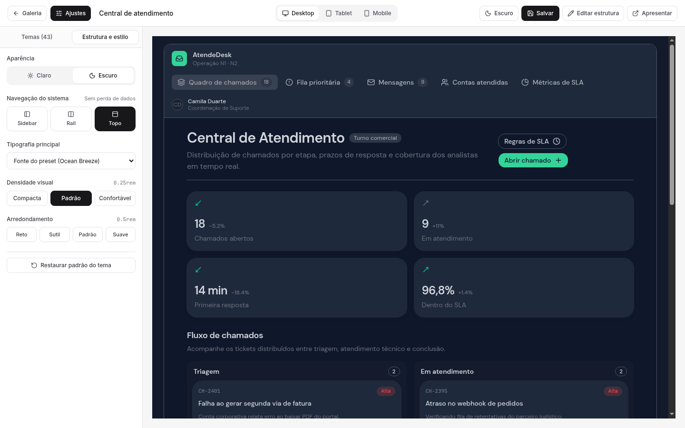

# AccioDesign

**Laboratório visual local para escolher estruturas prontas, experimentar identidades visuais e aprovar interfaces antes da implementação por agentes de IA ou equipes de engenharia.**

Construído sobre [Puck](https://github.com/puckeditor/puck), [shadcn/ui](https://ui.shadcn.com/), [Tweakcn](https://github.com/jnsahaj/tweakcn), [Tailwind CSS v4](https://tailwindcss.com/) e [React Router 7](https://reactrouter.com/), o AccioDesign funciona como um **provador visual de interfaces**: escolha um template ou comece em branco, teste 43 temas, tipografia, densidade e estilo de navegação em tempo real e edite blocos no Puck apenas quando necessário — tudo localmente, sem serviços pagos, autenticação ou nuvem proprietária.

---

## Fluxo de experimentação em 3 modos

| Modo | Rota | Papel no fluxo |
| --- | --- | --- |
| **Gallery (Início)** | `/` | Escolha um dos 3 templates iniciais, inicie uma estrutura em branco ou retome projetos salvos localmente. |
| **Experimentar (Playground)** | `/play/:projectId` | Provador visual rápido: alterne entre 43 presets Tweakcn, Claro/Escuro, tipografia, densidade, arredondamento, modo de navegação (`Sidebar`, `Rail compacto`, `Topo`) e viewports (`Desktop`, `Tablet`, `Mobile`) sem alterar o conteúdo do documento. |
| **Editar (Puck)** | `/projects/:projectId/edit` | Editor visual completo do Puck para reorganizar, editar propriedades, adicionar ou remover os 20 blocos disponíveis, com o plugin `Tema` integrado e Undo/Redo nativo. |
| **Apresentar** | `/projects/:projectId` | Renderização limpa e fiel para revisão ou demonstração, usando os mesmos componentes React e o tema persistido do projeto. |

Rotas legadas (`/*/edit` e `/*`) permanecem funcionais para compatibilidade com páginas criadas anteriormente.

---

## Capturas de tela

### Galeria inicial e projetos locais


### Modo Experimentar (Desktop, Tablet e Escuro + Menu Superior)





### Modo Apresentar


---

## Funcionalidades disponíveis (Implementadas)

### Galeria e 3 Templates Iniciais
- **Sistema administrativo:** navegação lateral adaptável, trilha de navegação (`BreadcrumbNav`), indicadores de carteira, barra de busca e filtros, listagem corporativa e formulário de cadastro rápido.
- **Dashboard operacional:** KPIs de disponibilidade e latência, saúde dos serviços (`StatusBadgeGroup`), card financeiro (`KpiCard`), equipe de plantão e tabela de movimentações recentes.
- **Central de atendimento:** indicadores de SLA, quadro visual de chamados editável (`KanbanBoard`), atendentes em linha e métricas por canal.
- **Estrutura em branco:** ponto de partida limpo para composição livre no editor Puck.

### Catálogo Administrativo (`shadcn/ui` + `Radix UI`)
20 componentes configurados em [app/puck/index.tsx](./app/puck/index.tsx), organizados em 6 categorias no painel do Puck e editáveis pelas propriedades nativas:

- **Navegação:** `Header`, `AppSidebar` (compatível com modos `Sidebar`, `Rail compacto` e `Menu superior`), `BreadcrumbNav`, `Footer`
- **Layout:** `PageHeader`, `DashboardGrid`, `TabsSection`, `Bento`, `KanbanBoard`, `Divider`
- **Cards:** `DashboardCard`, `CardGrid`, `UserSummaryCard`
- **Indicadores:** `Stats`, `KpiCard`, `StatusBadgeGroup`
- **Tabelas:** `DataTable` (com busca ao vivo no cliente), `KeyValueTable`
- **Formulários:** `FormBlock`, `FilterBar`

### Provador Visual de Identidades (Tweakcn)
Disponível tanto no **Modo Experimentar** quanto como plugin nativo (**Tema**) no editor Puck:

- **43 identidades visuais:** tema padrão do AccioDesign + 42 presets built-in do Tweakcn com amostras de cor.
- **Personalização em tempo real:** cores semânticas, tipografia (`font-sans`, `font-serif`, `font-mono` via Google Fonts), densidade visual (`spacing`), arredondamento (`radius`), sombras e alternância **Claro / Escuro**.
- **Troca de navegação não destrutiva:** alternar entre `Sidebar`, `Rail compacto` e `Menu superior` altera apenas `root.props.navigationMode` via contexto React, preservando integralmente blocos, slots e dados.
- **Isolamento do editor:** a identidade visual do próprio AccioDesign (Galeria, Playground e chrome do Puck) permanece neutra e independente do tema aplicado dentro do iframe de preview.

### Segurança e Persistência Local
- **Separação entre seed demonstrativo e dados de trabalho:**
  - [database.json](./database.json) versionado no repositório atua estritamente como **seed demonstrativo somente leitura** e nunca é sobrescrito por ações de usuário.
  - Projetos criados ou editados pelo usuário são gravados localmente em `.accio-data/projects.json` (e rotas legadas em `.accio-data/legacy-pages.json`), ambos **ignorados pelo Git** via [.gitignore](./.gitignore).
  - Na primeira execução após a atualização, páginas customizadas existentes fora do seed padrão são migradas automaticamente para `.accio-data/projects.json` sem perda de dados.
- **Zero serviços externos obrigatórios:** funciona 100% offline/local (apenas Google Fonts opcionais para fontes não locais).
- **Sanitização de temas importados:** allowlist estrita de tokens e bloqueio de CSS/JS inseguro em [app/theme/schema.ts](./app/theme/schema.ts).

---

## Decisões arquiteturais e limitações conhecidas

### Decisões arquiteturais
1. **Preview isolado por portal em `<iframe>` no Modo Experimentar:** em [app/components/playground/preview-frame.tsx](./app/components/playground/preview-frame.tsx), o preview utiliza `<Render>` do Puck com os mesmos componentes React da página publicada dentro de um `<iframe>` sincronizado com as folhas de estilo do app e com `applyThemeToDocument(themeDoc, iframeDoc)`. Isso garante responsividade real por media queries (`Desktop`, `Tablet`, `Mobile`), isolamento total entre o tema testado e o chrome da ferramenta, além de paridade visual com o Modo Apresentar.
2. **Estado visual concentrado em `root.props`:** tema (`root.props.theme`), densidade (`root.props.density`) e modo de navegação (`root.props.navigationMode`) ficam em `root.props` do mesmo documento Puck (`AppData`), permitindo transição direta entre **Experimentar**, **Editar** e **Apresentar** sem duplicar formatos ou reconstruir blocos.
3. **Suite de testes sem novas dependências externas:** `npm test` usa `esbuild` (já presente via Vite) + `node:test` nativo do Node.js para validar geração de templates, preservação de conteúdo, isolamento de persistência e integridade do catálogo Puck.

### Limitações conhecidas
- A persistência é baseada em arquivos JSON locais (`.accio-data/`) voltada para uso individual/local, sem controle de concorrência multiusuário, autenticação ou banco de dados externo.
- No Modo Experimentar, alterações em cores individuais avançadas, sombras detalhadas e importação/exportação CSS/JSON continuam concentradas na aba **Tema** dentro do Modo Editar (Puck), mantendo o provador focado em decisão rápida (presets, Claro/Escuro, navegação, tipografia, densidade e cantos).
- A alternância de navegação (`Sidebar`, `Rail`, `Topo`) aplica-se a templates e páginas que utilizam o bloco `AppSidebar`; estruturas em branco ou sem `AppSidebar` não exibem esse controle.
- A integração com TokenBridge e a exportação completa de pacotes estruturados para agentes implementadores permanecem planejadas para fases seguintes.

---

## Stack tecnológica

| Camada | Tecnologia |
| --- | --- |
| Framework & Roteamento | React 19, React Router 7 (SSR framework mode) |
| Bundler & Build | Vite 6, TypeScript 5.8 (`strict` + `verbatimModuleSyntax`) |
| Editor Visual | `@puckeditor/core` 0.24 |
| Design System & UI | Tailwind CSS v4 (`@tailwindcss/vite`), shadcn/ui (`radix-rhea`), Radix UI, Lucide |
| Temas & Tokens | Módulos adaptados do Tweakcn (Apache 2.0) |
| Testes Automatizados | `node:test` + `esbuild` |

---

## Instalação e execução local

### Pré-requisitos
- **Node.js** `>= 20.0.0`
- **npm** (ou gerenciador compatível)

### Passo a passo

```bash
# 1. Clonar o repositório
git clone https://github.com/leogoecking/AccioDesign.git
cd AccioDesign

# 2. Instalar dependências
npm install

# 3. Iniciar o servidor de desenvolvimento
npm run dev
```

Após iniciar o servidor:
- **Galeria inicial:** `http://localhost:5173/`
- **Modo Experimentar:** clique em **Experimentar** em qualquer template para abrir `/play/:projectId`
- **Modo Editar (Puck + Tweakcn):** `/projects/:projectId/edit`
- **Modo Apresentar:** `/projects/:projectId`

### Scripts disponíveis

```bash
npm test            # Executa a suíte de testes automatizados (node:test + esbuild)
npm run typecheck   # Gera rotas tipadas do React Router e executa tsc
npm run build       # Gera os bundles client e SSR em ./build
npm run start       # Inicia o servidor de produção via react-router-serve
```

---

## Projetos open source utilizados

- **[Puck](https://github.com/puckeditor/puck)** — Editor visual open source para React (MIT).
- **[puck-configs](https://github.com/puckeditor/puck-configs)** — Configurações de referência `shadcn-twblocks` que serviram de base para os blocos iniciais *(sem arquivo `LICENSE` próprio confirmado na raiz do checkout utilizado; nenhuma licença não confirmada é atribuída a ele)*.
- **[Tweakcn](https://github.com/jnsahaj/tweakcn)** — Presets, gerador de tokens Tailwind v4, sombras e manipulação de temas (Apache 2.0).
- **[shadcn/ui](https://github.com/shadcn-ui/ui)** — Primitivos e convenções de interface (MIT).
- **[Radix UI](https://github.com/radix-ui/primitives)** — Primitivos acessíveis de UI (MIT).
- **[Tailwind CSS](https://github.com/tailwindlabs/tailwindcss)**, **[React Router](https://github.com/remix-run/react-router)**, **[Vite](https://github.com/vitejs/vite)** e **[Lucide](https://lucide.dev)**.

---

## Roadmap

### Implementado
- [x] Estrutura base com Puck + React Router 7 + Vite + Tailwind CSS v4
- [x] Catálogo administrativo shadcn/ui com 20 blocos em 6 categorias (incluindo `KanbanBoard`)
- [x] Integração do Tweakcn como plugin nativo no Puck (`Tema`), com 43 presets, editor de tokens em tempo real e Claro/Escuro
- [x] Galeria visual inicial, 3 templates completos em pt-BR e fluxo unificado em 3 modos (**Experimentar**, **Editar**, **Apresentar**)
- [x] Troca instantânea de navegação (`Sidebar`, `Rail compacto`, `Menu superior`), densidade e tipografia preservando dados do documento
- [x] Separação entre seed demonstrativo versionado (`database.json`) e projetos locais ignorados pelo Git (`.accio-data/`)

### Planejado (próximas etapas)
- [ ] **Integração com TokenBridge:** sincronização bidirecional e validação de contratos de design tokens para handoff padronizado.
- [ ] **Exportação para agentes de IA:** geração de pacotes de contexto (estrutura de componentes Puck + tokens aprovados + diretrizes visuais) prontos para consumo por agentes implementadores.
- [ ] **Comparação rápida entre identidades:** visualização lado a lado e histórico nomeado de variações aprovadas.

---

## Licenciamento e créditos

O **AccioDesign** é licenciado sob a **Apache License, Version 2.0**. Consulte:
- [LICENSE](./LICENSE) — texto integral da licença Apache 2.0;
- [NOTICE](./NOTICE) — avisos legais do projeto e atribuições;
- [THIRD_PARTY_NOTICES.md](./THIRD_PARTY_NOTICES.md) — mapeamento detalhado de módulos reutilizados, origens e adaptações realizadas.
