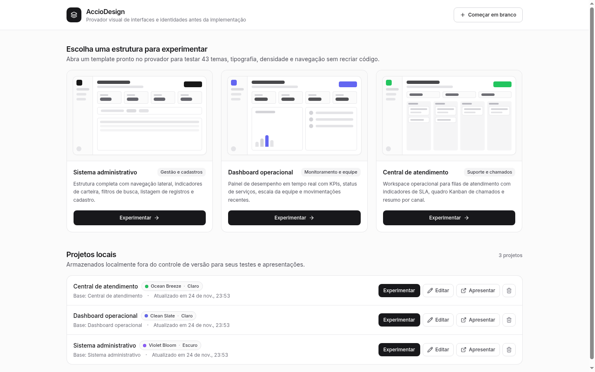
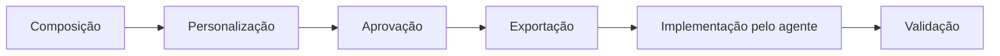
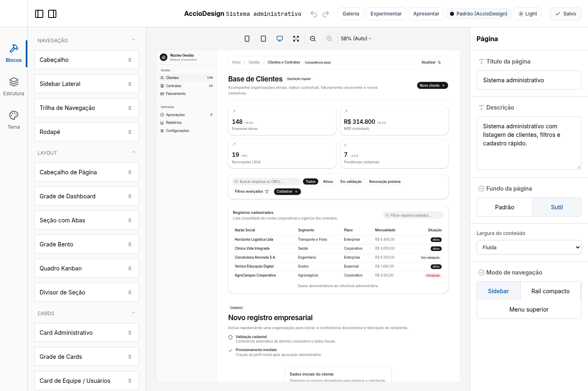
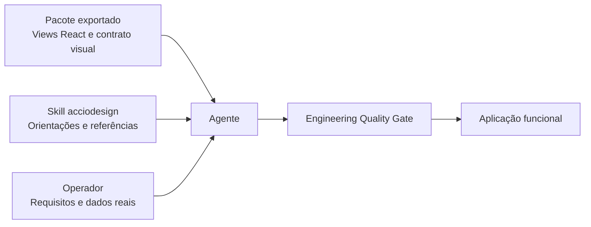

# AccioDesign

**Editor visual local para compor, aprovar e exportar interfaces em React.**

Escolha uma estrutura, experimente temas e aprove o resultado no navegador antes de implementar as funcionalidades. O AccioDesign exporta um **frontend React reutilizável e executável**, junto com o contrato visual e uma skill que orienta agentes a trabalhar sobre o código aprovado. Assim, a equipe pode evoluir a interface sem recomeçar a implementação a partir de uma captura, um protótipo ou um prompt.

- **Composição visual** com Puck, três templates, uma estrutura em branco e um catálogo de 30 blocos (incluindo **Gráficos e análise** e **Informações e atividades** com `ActivityTimeline`, `RecordList`, `ProgressCard`, `AgendaCard` e `NotificationList`).
- **Personalização em tempo real** com 43 presets, temas claro e escuro, tipografia, densidade, largura e navegação.
- **Exportação local** com o documento, os tokens e as views React usadas na apresentação.
- **Integração com agentes** com instruções de reutilização e verificação para Codex e Antigravity.

O editor usa React, React Router e Puck. A interface usa Tailwind CSS v4, shadcn/ui, primitivas adaptadas do Spell UI e Recharts (incluídos seletivamente apenas quando os blocos correspondentes são usados no projeto), com módulos de tema adaptados do Tweakcn e de exportação adaptados do TokenBridge.



[Início rápido](#início-rápido) · [Agent Skill](#agent-skill) · [Pacote exportado](#pacote-exportado) · [Arquitetura e desenvolvimento](#arquitetura-e-desenvolvimento)

## Como funciona



| Modo | O que fazer |
| --- | --- |
| **Galeria** · `/` | Abra Sistema administrativo, Dashboard operacional ou Central de atendimento. Você também pode começar em branco ou retomar um projeto local. |
| **Experimentar** · `/play/:projectId` | Compare temas, navegação e tamanhos de tela. Ajuste tipografia, cantos, densidade e largura. Salve a proposta aprovada e exporte. |
| **Editar** · `/projects/:projectId/edit` | Use o Puck para organizar blocos e slots, editar propriedades e configurar tokens individuais na aba **Tema**. |
| **Apresentar** · `/projects/:projectId` | Revise a página salva sem os controles de edição. Esta é a referência visual para o frontend exportado. |


## Início rápido

### 1. Rode o AccioDesign

Use Git, npm e Node.js **22.20 ou superior** para seguir o tutorial completo, incluindo a instalação pelo Skills CLI.

Na pasta onde deseja clonar o projeto, execute os comandos abaixo. Esta é a instalação do **AccioDesign**, onde você vai compor e exportar a interface.

```bash
git clone https://github.com/leogoecking/AccioDesign.git
cd AccioDesign
npm ci
npm run dev
```

Abra [localhost:5173](http://localhost:5173/) ou o endereço informado pelo Vite.

### 2. Componha e personalize

Na **Galeria**, clique em **Experimentar** num template. Para partir de uma página vazia, use **Começar em branco** e abra **Editar estrutura**. No editor, adicione e configure os blocos. Em **Experimentar**, escolha um tema e use **Estrutura e estilo** para ajustar largura, navegação e demais opções do projeto. Confira as prévias Desktop, Tablet e Mobile.



### 3. Aprove e exporte

Salve as alterações e abra **Apresentar** para revisar a interface. Depois, volte a **Experimentar** e clique em **Exportar design**. Se houver alterações pendentes, confirme o salvamento para que o ZIP use o estado aprovado.

### 4. Rode o frontend extraído

Extraia o ZIP em outra pasta. Abra um terminal **na raiz do pacote extraído** e entre em `frontend/`. Os comandos abaixo são do **projeto exportado**.

```bash
cd frontend
npm install
npm run dev
```

Abra a URL informada pelo Vite. O projeto tem suas próprias dependências e funciona sem o servidor do AccioDesign. Use `npm run typecheck` para conferir os tipos e `npm run build` para produzir `dist/` para hospedagem estática.

### 5. Passe o fluxo ao agente

[Instale a skill](#instalação-e-ativação), abra o pacote extraído no seu agente e descreva o comportamento que deve funcionar. Informe as fontes de dados, as regras relevantes e como você pretende testar o resultado. Para integrar em outro repositório, abra o projeto de destino e indique o caminho da exportação.

## Agent Skill

Uma Agent Skill é um conjunto de instruções que um agente consulta para executar um tipo de tarefa. A skill `acciodesign` explica como interpretar o pacote, reaproveitar os componentes React e demonstrar que a implementação preservou o design aprovado enquanto conectava funcionalidades reais. [Padrão Agent Skills](https://agentskills.io/specification)



### O que o agente lê

Na descoberta, o agente conhece o nome e a descrição da skill. Na ativação, lê o `SKILL.md` e consulta apenas as referências úteis ao fluxo. Esse carregamento progressivo mantém o contexto focado na tarefa. A [fonte canônica](./skills/acciodesign/) fica no repositório, e o ZIP leva uma cópia com a versão usada na exportação.

| Arquivo | Quando consultar |
| --- | --- |
| [`SKILL.md`](./skills/acciodesign/SKILL.md) | Ao ativar. Delimita a tarefa e indica as referências. |
| [`integration.md`](./skills/acciodesign/references/integration.md) | Ao verificar o pacote e escolher como iniciar um projeto ou adaptar um existente. |
| [`visual-contract.md`](./skills/acciodesign/references/visual-contract.md) | Ao inventariar campos, ações, indicadores e componentes e preservar a composição após conectar dados. |
| [`business-logic.md`](./skills/acciodesign/references/business-logic.md) | Ao definir invariantes, persistência e testes de uma regra. |
| [`validation.md`](./skills/acciodesign/references/validation.md) | Ao registrar a referência inicial e aplicar o Engineering Quality Gate. |

O **contrato visual** registra aparência, estrutura, estados e componentes. Os **requisitos funcionais** definem dados reais, regras do domínio, permissões e comportamento. Campos, indicadores e ações demonstrativas ajudam a ler o design. O agente usa os requisitos do operador e as regras confirmadas do projeto para decidir o que conectar.

Ao integrar, reaproveite as views fornecidas ou as equivalentes no destino e conecte dados por props, callbacks ou adaptadores. Compare a tela renderizada com o inventário do fluxo e justifique substituições ou remoções. Uma alteração visual pedida pelo usuário faz parte do escopo e pode ser aplicada ao trecho indicado. Cabe ao desenvolvedor ou operador definir o escopo e as regras, fornecer os dados e acessos adequados, decidir sobre diferenças e aprovar a entrega.

### Instalação e ativação

**Recomendado para Codex e Antigravity.** Rode o Skills CLI em um terminal com acesso à rede e selecione seus agentes quando solicitado.

```bash
npx skills add leogoecking/AccioDesign --skill acciodesign -g
```

O comando instala no escopo do usuário. A cópia compartilhada fica em `~/.agents/skills/acciodesign/`. O CLI também pode criar links ou cópias nos caminhos dos agentes selecionados. Na verificação com Codex e Antigravity selecionados, o CLI instalou também em `~/.gemini/config/skills/acciodesign/` para o Antigravity. Confira a instalação com `npx skills list -g`. [Skills CLI e caminhos de instalação](https://github.com/vercel-labs/skills/blob/main/docs/agents.md)

| Agente | Como conferir | Como ativar explicitamente |
| --- | --- | --- |
| **Codex** | Use `/skills` ou procure a skill ao digitar `$`. Se preciso, inicie uma nova sessão. | Mencione `$acciodesign` no pedido. |
| **Antigravity** | No CLI, abra `/skills` e, se necessário, execute `/skills reload`. No App ou IDE, confira as personalizações do workspace. | Use `/acciodesign` na caixa de mensagem. |

[Descoberta e ativação no Codex](https://learn.chatgpt.com/docs/build-skills#how-chatgpt-and-codex-use-skills) · [Skills no Antigravity](https://antigravity.google/docs/skills)

**Atualização.** Para atualizar apenas a instalação global da skill, execute o comando abaixo e reabra a lista de skills do agente.

```bash
npx skills update acciodesign -g
```

[Comandos oficiais do Skills CLI](https://github.com/vercel-labs/skills/blob/main/docs/commands.md#skills-update)

### Cópia portátil, instalação local e duplicidade

A **versão global** acompanha as atualizações obtidas do repositório com o Skills CLI. A **cópia portátil** em `skills/acciodesign/` é um retrato da versão que acompanhou o ZIP. Você pode consultá-la offline e indicar ao agente o caminho do `SKILL.md` com suas referências. O acesso a esses arquivos é local. O agente e a primeira instalação das dependências podem precisar de rede.

Se precisar fixar a skill num projeto, copie a pasta portátil inteira `skills/acciodesign/` para `.agents/skills/acciodesign/` no workspace de destino. Com o Skills CLI disponível, outra opção é executar o comando abaixo **na raiz do projeto de destino**, apontando para a pasta portátil. A ausência de `-g` seleciona o escopo do projeto.

```bash
npx skills add /caminho/do/pacote/skills/acciodesign --skill acciodesign
```

Mantenha uma só cópia ativa por workspace. A pasta portátil dos ZIPs novos fica fora do caminho de descoberta automática. Se o Codex mostrar duas entradas, confira os caminhos em `/skills` e compare `npx skills list` com `npx skills list -g`. Para manter a global, retire a cópia local do caminho de descoberta. Se o Skills CLI instalou a cópia local, use `npx skills remove acciodesign` **na raiz do projeto e sem `-g`**. Se veio de um ZIP antigo ou foi copiada manualmente, mova somente a pasta local `.agents/skills/acciodesign/` para um local de arquivo e reinicie a sessão. [Escopos e remoção no Skills CLI](https://github.com/vercel-labs/skills/blob/main/docs/commands.md#skills-remove)

### Como pedir uma implementação

Em um **projeto novo**, parta de `frontend/`. Em um **projeto existente**, indique o caminho do pacote extraído, a rota ou os componentes alvo e as interfaces de dados existentes. Peça ao agente para inspecionar primeiro as convenções do destino, manter os arquivos que já funcionam e integrar somente as views necessárias.

Use `$acciodesign` no Codex ou `/acciodesign` no Antigravity antes de um pedido como estes.

| Objetivo | Exemplo de pedido |
| --- | --- |
| Criar a partir do frontend exportado | “Use `frontend/` deste pacote para montar o painel. Carregue os registros do JSON que anexei e preserve a composição aprovada.” |
| Integrar a um projeto existente | “Integre o pacote em `/relatorios` no meu projeto. Reutilize nossas rotas e componentes compatíveis e indique as adaptações.” |
| Implementar uma funcionalidade | “Conecte a busca da tabela à API documentada no projeto. Exiba carregamento, vazio e erro e teste os filtros.” |
| Alterar um elemento visual | “Troque apenas a cor de destaque do cabeçalho pelo token secundário. Preserve as outras áreas e confira em claro e escuro.” |

### Engineering Quality Gate

O Quality Gate é um roteiro de verificação aplicado pelo agente. A execução das verificações cabe ao agente, e a revisão das evidências e a aprovação da entrega cabem ao operador. A qualidade do resultado depende dessas etapas.

| Critério | Evidência esperada |
| --- | --- |
| Funcionalidades solicitadas | Fluxos e estados solicitados executados com resultado observado. |
| Regras de negócio | Testes automatizados das invariantes novas ou alteradas. |
| Persistência e integridade | Nova leitura após salvar e falhas pertinentes com os dados anteriores preservados. |
| Separação de responsabilidades | Pontos de entrada testáveis para apresentação, domínio, persistência e estado quando aplicável. |
| Alterações visuais | Inventário confrontado com a tela renderizada e justificativa das diferenças. |
| Reutilização de componentes | Registro do que foi reutilizado, modificado ou criado. |
| Responsividade e runtime | Tela conferida nos tamanhos, temas e estados afetados, com foco e estado estáveis quando aplicável. |
| Typecheck e build | Resultado dos comandos aplicáveis ao destino. |

Use **aprovada** com evidência satisfatória, **reprovada** quando foi constatada uma falha, **não aplicável** com o motivo do critério estar fora do fluxo ou **não verificada** quando falta evidência. A referência descreve como registrar os resultados e corrigir falhas relevantes. [Procedimento do Quality Gate](./skills/acciodesign/references/validation.md#quality-gate)

## Pacote exportado

```text
projeto.zip
├── manifest.json
├── design.json
├── tokens.json
├── theme.css
├── DESIGN.md
├── components.md
├── SKILL.md
├── frontend/
│   ├── README.md
│   ├── package.json
│   ├── index.html
│   ├── tsconfig.json
│   ├── vite.config.ts
│   ├── src/
│   │   ├── main.tsx
│   │   ├── design.json
│   │   └── theme.css
│   ├── LICENSE
│   ├── NOTICE
│   ├── THIRD_PARTY_NOTICES.md
│   └── licenses/
└── skills/
    └── acciodesign/
        ├── SKILL.md
        └── references/
            ├── integration.md
            ├── visual-contract.md
            ├── business-logic.md
            └── validation.md
```

| Caminho | Responsabilidade |
| --- | --- |
| `manifest.json` | Identifica o projeto, o formato `acciodesign.design-export` na versão 1.0 e as condições de compatibilidade. |
| `design.json` | Documento Puck salvo, com hierarquia, propriedades e slots. |
| `tokens.json` e `theme.css` | Tokens de Light e Dark e CSS com as regras visuais compartilhadas. |
| `DESIGN.md` e `components.md` | Decisões registradas, limites e inventário dos componentes usados. |
| `SKILL.md` | Entrada legada gerada da fonte canônica, com links relativos à raiz do ZIP. |
| `frontend/` | Projeto React, TypeScript e Vite. O `package.json` declara dependências e comandos, `index.html` carrega a entrada e os arquivos de configuração definem o build e a tipagem. Em `src/` ficam as views, o ponto de entrada e as cópias do documento e do tema. |
| `frontend/LICENSE`, `frontend/NOTICE`, `frontend/THIRD_PARTY_NOTICES.md` e `frontend/licenses/` | Licenças e atribuições do código exportado. |
| `skills/acciodesign/` | Cópia portátil completa da skill, com a entrada principal e as quatro referências. |

O ZIP é gerado localmente do projeto salvo. Comece em `frontend/src/main.tsx` para conectar as views a dados reais. Revise o conteúdo do projeto antes de compartilhar o arquivo, especialmente textos livres e URLs.

## Arquitetura e desenvolvimento

- [Arquitetura, persistência e limitações](./docs/arquitetura.md). Catálogo de blocos, temas, layout responsivo, segurança, exportação e identidade dos slots React.
- [Validação e regressões](./docs/validacao.md). Comandos de teste, execução independente do frontend, matriz responsiva e resultados históricos.
- [Avisos e dependências de terceiros](./THIRD_PARTY_NOTICES.md). Origem, adaptações e licenças de Puck, puck-configs, Tweakcn, shadcn/ui, Spell UI, Recharts e TokenBridge.

Para verificar uma alteração no repositório principal, execute `npm test`, `npm run typecheck` e `npm run build`.

## Roadmap

**Implementado**

- Puck e catálogo de componentes.
- Tweakcn e personalização visual.
- Galeria e templates.
- Adaptação do TokenBridge.
- Exportação React executável.
- Estabilidade do runtime e responsividade global.
- Agent Skill e Engineering Quality Gate.

**Próximas etapas**

- Homologação prática da skill aprimorada.
- Benchmark de qualidade e consumo de tokens.
- Expansão do catálogo de componentes e templates.
- Composição de aplicações com múltiplas páginas.
- Personalização de marca.
- Exportação de componentes individuais.

**Possibilidades futuras** incluem comparação de propostas e validação visual independente.

## Licença

AccioDesign é distribuído sob a [Apache License 2.0](./LICENSE). Consulte também os [avisos do projeto](./NOTICE) e as [atribuições de terceiros](./THIRD_PARTY_NOTICES.md).
